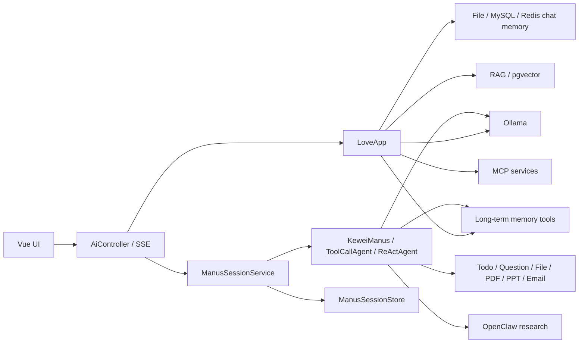

# Kewei AI Agent

**English** | [简体中文](README.zh-CN.md)

A hands-on AI Agent project built with **Spring Boot + Spring AI + Vue 3**. Explore contextual chat, streaming replies, multi-step tasks, RAG, tools, MCP and memory through a browser UI and Java backend.

This project is for learning, extension and local demos. The frontend can run independently; the full backend needs configured models, a database and enabled MCP services. Production authentication, rate limiting and auditing are not complete. Do not expose it directly to the public internet.

[Screenshots](#screenshots) · [Quick start](#quick-start) · [Examples](#examples) · [ToolTape](#optional-tooltape-integration) · [Deployment](#deployment) · [Tests](#tests) · [Architecture](#architecture) · [Upgrade log](#upgrade-log) · [Next upgrades](#next-upgrades)

## Screenshots

Real landing-page captures of the built Vue frontend at commit `3027eeb`, from [the successful CI run](https://github.com/keweizhuazuki/kewei-ai-agent/actions/runs/38033736809). These are frontend-only Chromium viewport previews, without a live backend or model connection; the mobile view is not physical-device verification.

**Desktop · 1440 × 1000**


<details>
<summary>Mobile viewport · 390 × 844</summary>


</details>

## Features

| Feature | Current implementation and boundaries |
| --- | --- |
| LoveApp | Synchronous / SSE chat, session memory and image questions with a compatible model |
| Manus | Multi-step tool use, TodoWrite progress, AskUserQuestion and answer-based continuation |
| RAG | Markdown loading, local vectors / pgvector, query preprocessing, keyword enrichment and retrieval filters; mainly exposed through the application layer |
| Memory | File / MySQL / Redis chat memory plus separate Markdown long-term memory tools |
| Tools | File operations, downloads, PDF-to-image, PPT creation, time and email; external services require configuration |
| Extensions | Image-search / generation MCP projects and OpenClaw CLI research delegation |
| Browser UI | `/` home, `/chat` conversations, `/console` health and API debugging; ExerciseApp is a reserved entry |

**Stack:** Java 21, Spring Boot 4, Spring AI 2.0.0-M2, Maven, Vue 3, Vite 7, Pinia, Ollama, PostgreSQL / pgvector.

Ollama is the default provider. DashScope dependencies and examples remain, but its auto-configuration is excluded. Switching providers requires reviewing configuration and model beans, not just replacing an API key.

## Quick start

### 1. Preview the frontend

Install Git, **Node.js 22.12+** and npm. These commands work in macOS / Linux terminals and Windows PowerShell. UI-only preview needs no model, database or API key.

```bash
git clone https://github.com/keweizhuazuki/kewei-ai-agent.git
cd kewei-ai-agent/kewei-ai-agent-frontend
npm ci
npm run dev
```

Open the URL printed by Vite, normally `http://localhost:5173`. Without a backend, pages render but chat, uploads and health checks cannot succeed.

> The locked Vite 7 and Vue plugin require Node `^20.19.0 || >=22.12.0`; Node 18 is insufficient. Backend compilation needs **JDK 21**, not only a JRE. The Maven Wrapper downloads Maven and dependencies on first use, so a separate Maven installation is unnecessary.

### 2. Prepare backend dependencies

| Dependency | Required for |
| --- | --- |
| Ollama | Default chat and embedding; startup loads documents and calls models |
| PostgreSQL + pgvector | Default datasource and vector store; not optional in the current startup wiring |
| MCP servers | Enabled by default; every configured server must be able to start |
| MySQL / Redis | Only for the selected chat-memory implementation; you can start with `file` |
| OpenClaw CLI | Web research and PPT tasks that require research |
| SMTP / image-service credentials | Email, image search or image generation when used |

Ollama defaults to `http://localhost:11434`; model names come from [`application.yml`](src/main/resources/application.yml):

```bash
ollama pull qwen3.5:35b
ollama pull mxbai-embed-large:latest
```

The default chat model is resource-intensive. You can configure another model appropriate for your hardware, but tools and image input require model support. The pgvector dimension is `1024`; changing embeddings also requires checking dimensions and existing vector data.

Create a PostgreSQL database, then enable this extension using an authorized database account:

```sql
CREATE EXTENSION IF NOT EXISTS vector;
```

### 3. Add private configuration

Create `src/main/resources/application-local.yml`, which is Git-ignored. The default profiles are `local,ollama`. Set the referenced environment variables before starting; never commit credentials.

```yaml
spring:
  datasource:
    url: ${POSTGRES_URL}
    username: ${POSTGRES_USERNAME}
    password: ${POSTGRES_PASSWORD}
    driver-class-name: org.postgresql.Driver
  sql:
    init:
      mode: never

app:
  chat-memory:
    type: file
    file-dir: ${CHAT_MEMORY_DIR:${user.dir}/tmp/chat-memory}
  long-term-memory:
    dir: ${LONG_TERM_MEMORY_DIR:${user.dir}/tmp/agent-memory}
```

Use a JDBC URL such as `jdbc:postgresql://localhost:5432/kewei_ai_agent`. Set variables with `export NAME='value'` on macOS / Linux or `$env:NAME='value'` in PowerShell, in the terminal that launches the backend. Enter sensitive values only in your own environment.

Optional settings in the same file:

- **MySQL memory:** `app.chat-memory.type=mysql`; set `app.datasource.mysql.url / username / password / driver-class-name`, using driver `com.mysql.cj.jdbc.Driver`.
- **Redis memory:** `app.chat-memory.type=redis`; set `spring.data.redis.host / port` and required authentication.
- **Email:** `mail.smtp.host / port / username / password / from / ssl`. Configured tools send real email, so use test accounts and recipients.
- **OpenClaw:** `openclaw.agent.command / id / timeout-seconds / session-prefix`. The default command `openclaw` must be configured and available in the backend's PATH.
- **Standalone web search:** `search-api.api-key`. Manus research currently routes to OpenClaw instead.

**Check MCP separately.** [`mcp-servers.json`](src/main/resources/mcp-servers.json) contains a placeholder AMap key and relative paths to two local JARs. Configure the services you need, then build their projects from the repository root:

```bash
./mvnw -f kewei-image-search-mcp-server/pom.xml package -DskipTests
./mvnw -f kewei-image-generation-mcp-server/pom.xml package -DskipTests
```

Use `.\mvnw.cmd` instead of `./mvnw` in PowerShell. These commands skip tests. Private MCP settings can live in ignored `tmp/mcp-servers.json`, referenced by `spring.ai.mcp.client.stdio.servers-configuration: file:./tmp/mcp-servers.json` in local configuration. Every retained server must work; `LoveApp` injects `ToolCallbackProvider`, so review bean wiring before disabling the entire MCP client.

### 4. Start the backend

Keep the frontend running and open another terminal at the repository root.

macOS / Linux:

```bash
./mvnw spring-boot:run
```

Windows PowerShell:

```powershell
.\mvnw.cmd spring-boot:run
```

- Backend API: `http://localhost:8123/api`
- Health: `http://localhost:8123/api/health`
- Swagger: `http://localhost:8123/api/swagger-ui.html`

Check the health URL, then click “立即检查” (Check now) at `/console`. A successful response confirms HTTP availability, not every model or tool. Initial document embedding and keyword enrichment may take time; inspect startup logs.

## Examples

These are suggested inputs and steps, not recorded model outputs. Results depend on the model, configured tools and service availability.

### LoveApp: contextual chat

1. Open `/chat`, select **LoveApp** and “事件流 sse_emitter” (event stream).
2. Try: `Help me outline a calm conversation about sharing household chores.`
3. Keep the same `chatId`: `Turn that outline into three opening sentences.`
4. “新建 chatId” starts another conversation. “上传图片” uploads an image for a question when the model supports images.

The frontend remembers recent chat IDs, not a complete rendered message history. Backend memory uses the selected storage implementation; switching or refreshing pages is not full history restoration.

### Manus: plan → ask → continue

Select **Manus** at `/chat` and try:

```text
Create a three-day Spring AI learning plan. First use AskUserQuestion to ask how much time I have each day, then use TodoWrite to plan tasks and suggest exercises. Do not research online or send email.
```

When the model calls the relevant tools:

1. `question` opens “需要补充信息” (more information needed).
2. Answer and click “继续执行” (continue) to submit answers to the continuation endpoint.
3. `todo` updates “当前任务” (current task); completed snapshots move into chat history.
4. `message` appends output and `done` ends the current stream. Inspect errors before retrying a failed stream.

Tool use is model-driven. Manus pending questions and Todo snapshots are in-memory and cannot survive a backend restart. They are separate from file / MySQL / Redis chat memory.

Creating or switching chats is disabled while a response is active. After a question pause, changing chats clears the old pending questions, answers and pinned Todo from the UI. Failed continuation preserves answers for retry in the same chat; successful continuation updates and archives the latest Todo state.

### API examples

All routes below use the prefix `http://localhost:8123/api`.

| Method | Route | Purpose |
| --- | --- | --- |
| GET | `/health` | HTTP health check |
| GET | `/ai/love_app/chat/sync` | Synchronous chat |
| GET | `/ai/love_app/chat/sse` | Streaming chat |
| GET | `/ai/love_app/chat/sse_emitter` | Named `message` / `done` events |
| POST | `/ai/love_app/image/upload` | Multipart image upload: `chatId` + `file` |
| GET | `/ai/manus/chat` | Start with `chatId` + `message` |
| POST | `/ai/manus/chat/continue` | Submit answers and resume streaming |

macOS / Linux streaming request:

```bash
curl -N -G 'http://localhost:8123/api/ai/love_app/chat/sse_emitter' \
  --data-urlencode 'chatId=readme-demo' \
  --data-urlencode 'message=Help me outline a calm conversation about household chores.'
```

PowerShell uses `curl.exe` to avoid alias conflicts:

```powershell
curl.exe -N -G "http://localhost:8123/api/ai/love_app/chat/sse_emitter" --data-urlencode "chatId=readme-demo" --data-urlencode "message=Help me outline a calm conversation about household chores."
```

For continuation, replace the answer key with the actual question ID from the `question` event:

```json
{
  "chatId": "readme-demo",
  "answers": {
    "question-id-from-event": "One hour per day"
  }
}
```

For a minimal Todo demo, pass `option=todo-demo` to `/ai/love_app/chat/sse_emitter`. Use Manus for the full question-and-progress UI.

## Optional ToolTape integration

[ToolTape](https://github.com/keweizhuazuki/tooltape) records and replays **tool callbacks**, not model responses or whole Agent runs. This opt-in adapter wraps the `allTools` and `memoryTools` beans. MCP providers and other operations outside those arrays are not intercepted; running the full application still requires its usual model and service setup.

### Build and test the pinned integration

From the repository root, initialize the exact submodule revision pinned by this repository, then activate the Maven profile:

```bash
git submodule update --init --recursive
./mvnw -Ptooltape clean "-Dtest=ToolTape*,ToolCallAgentTest,ToolRegistrationTest" test
./mvnw -Ptooltape package -DskipTests
```

Use `.\mvnw.cmd` in PowerShell. Do not use `git submodule update --remote` for a reproducible build. A clean default build without `-Ptooltape` excludes ToolTape and its adapter; even a profile-enabled build defaults to runtime mode `off`. Use `clean` when switching build profiles to remove stale compiled classes.

### Runtime settings

| Property | Default | Meaning |
| --- | --- | --- |
| `kewei.tooltape.mode` | `off` | `off`, `record` or `replay` |
| `kewei.tooltape.path` | Unset | Required tape path for record/replay; recording refuses to overwrite an existing file |
| `kewei.tooltape.input-fields` | Empty | Comma-separated allowlist of reviewed top-level scalar inputs; excluded values are not captured or compared |
| `kewei.tooltape.capture-output` | `false` | Explicitly enables storing the complete tool-return string |

**Privacy first:** Empty input/output allowlists retain tool names, order, timing and exception types, but no argument or return values. A recording without a captured result cannot faithfully replay that result: replay fails clearly, with no placeholder response and no fallback to the live tool. `ToolContext` is passed in memory only, never written to the tape. These defaults apply to tape capture, not existing application logs or model requests.

**Synthetic fixtures only for output capture.** `capture-output=true` stores the entire returned string, which can include credentials or private data; it is not content sanitization. Review every captured input and output, use a dedicated test process, and keep tapes out of commits. Recording executes the real wrapped tool and can cause side effects. The synthetic [Agent dispatch regression](src/tooltape-test/java/com/kiwi/keweiaiagent/tooltape/ToolTapeAgentReplayTest.java) is the safer starting point and needs no live model.

To try runtime capture with reviewed synthetic data, first create `tmp/tooltape` (`mkdir -p tmp/tooltape` on macOS/Linux, or `New-Item -ItemType Directory -Force tmp/tooltape` in PowerShell), then run:

```bash
java -jar target/kewei-ai-agent-0.0.1-SNAPSHOT.jar --kewei.tooltape.mode=record --kewei.tooltape.path=tmp/tooltape/synthetic.tape --kewei.tooltape.capture-output=true
```

Exercise the relevant wrapped tools in **one serial test session**, then shut down the application gracefully so Spring closes the recorder and writes the completion marker. Restart with the same capture policy to replay the same ordered tool calls:

```bash
java -jar target/kewei-ai-agent-0.0.1-SNAPSHOT.jar --kewei.tooltape.mode=replay --kewei.tooltape.path=tmp/tooltape/synthetic.tape --kewei.tooltape.capture-output=true
```

This example leaves the input allowlist empty; add the same reviewed `kewei.tooltape.input-fields` value to both runs to compare selected arguments. New v2 recordings must be closed and use the same policy; missing files, incomplete recordings and policy mismatches fail. Closing replay also checks that all recorded calls were consumed.

The adapter uses one process-wide ordered session and rejects concurrent or recursive tool calls. It is not ready for production multi-user capture. Replay substitutes only wrapped tools; the model is still live unless separately stubbed, and may generate a different call sequence.

## Deployment

### API address and builds

The default `http://localhost:8123/api` points to the **browser's device**. For deployment or mobile access, use a backend address reachable from that device. Set `kewei-ai-agent-frontend/.env.local`, replacing the example domain:

```dotenv
VITE_API_BASE_URL=https://your-api.example.com/api
```

Keep `/api` and omit a trailing slash. `VITE_API_BASE_URL=/api` also works behind a same-origin reverse proxy that forwards `/api` to the backend. Vite currently has no development API proxy, so use a full backend URL when frontend and backend run on different ports.

`VITE_` variables are public, build-time values, never a place for secrets. Rebuild after changing them:

```bash
cd kewei-ai-agent-frontend
npm ci
npm run build
npm run preview
```

`preview` checks `dist` locally; it is not a production server.

- Serve `dist` with history fallback to `index.html` for routes such as `/chat` and `/console`.
- Use HTTPS APIs from HTTPS pages to avoid mixed-content blocking.
- Configure reverse-proxy SSE buffering and read timeouts.
- Add authentication, tool permissions and rate limits before public exposure; restrict the current permissive CORS settings.

Package the backend from the repository root:

```bash
./mvnw package -DskipTests
java -jar target/kewei-ai-agent-0.0.1-SNAPSHOT.jar
```

PowerShell uses `.\mvnw.cmd package -DskipTests`; the Java command is the same. Skipping tests is not verification. Models, database, MCP and private configuration must still be ready. Run from the repository root to keep relative output, memory and MCP paths consistent.

### Platform coverage

| Platform | Status |
| --- | --- |
| Linux | Selected backend unit tests, frontend tests and build verified in a Linux cloud environment; no full external-service integration validation |
| macOS | Use `./mvnw` and npm; runtime not yet verified |
| Windows | Use PowerShell, `.\mvnw.cmd`, `curl.exe`; runtime not yet verified |
| Mobile / tablet | Browser clients of a deployed frontend, not hosts for this Java backend or Ollama |

For trusted-LAN testing only, use `npm run dev -- --host 0.0.0.0`, configure a reachable LAN backend URL and check firewall rules. Do not expose the development server directly to the internet.

## Tests

Run focused backend regression tests without live models from the repository root:

```bash
./mvnw "-Dtest=BaseAgentTest,ManusSession*Test,Memory*Test,FileOperationToolTest,ResourceDownloadToolTest,PdfConvertToolTest,OpenClawResearchToolTest,ShellOpenClawCommandRunnerTest" test
./mvnw -DskipTests compile
```

Use `.\mvnw.cmd` in PowerShell. Frontend tests use Node's built-in runner and cover SSE parsing, URLs, connection lifecycle and chat-state regressions:

```bash
cd kewei-ai-agent-frontend
npm ci
npm test
npm run build
```

A full `./mvnw test` also includes application-context tests requiring real models, databases, MCP or network access. Focused passes are not a full-suite pass. PDF tests generate temporary samples and cover subdirectories and collisions; the manual email test is disabled. Browser flows and real service calls need separate integration validation.

The [regression workflow](.github/workflows/ci.yml) runs on pull requests and pushes to `main`: Java 21 executes 19 self-contained backend test classes, and Node 24 runs frontend tests plus a production build. Official actions are pinned to commit SHAs, repository permission is read-only, and application secrets are not used. Real model, database, SMTP and public-web integration tests are excluded.

The frontend job also captures actual desktop/mobile viewport previews with Playwright and uploads a `ui-previews` artifact. These previews start only the built UI, not a backend or model. To capture the same views locally after building:

```bash
npx playwright install chromium
npm run screenshots
```

Run these commands in `kewei-ai-agent-frontend`; use a supported browser environment. Capture files are written to `docs/images/` and must be visually reviewed before they are added to documentation.

For browser interaction checks, run the new fixture-driven suite after `npm run build` and Chromium installation:

```bash
npm run test:ui
npm run test:ui -- --screenshots
```

The second command also requests chat screenshots. The [browser suite](kewei-ai-agent-frontend/scripts/ui-flows.mjs) uses real Chromium with intercepted synthetic API/SSE responses: continuation with failure/retry and Todo completion, new chat, chat switching, and failed-send retry, each at desktop and mobile-sized viewports (**8 scenarios**). It needs no live backend or model. Hosted execution and chat screenshot review are still pending for this revision; these scenarios are not yet reported as passing.


## Architecture



- [LoveApp](src/main/java/com/kiwi/keweiaiagent/app/LoveApp.java): chat, structured output, images, RAG, Tools, MCP and Skills. Not every method has a UI button.
- [ManusSessionService](src/main/java/com/kiwi/keweiaiagent/agent/ManusSessionService.java) / [ManusSessionStore](src/main/java/com/kiwi/keweiaiagent/agent/ManusSessionStore.java): routing, tool subsets, questions, Todo snapshots and continuation.
- [ChatMemoryConfig](src/main/java/com/kiwi/keweiaiagent/config/ChatMemoryConfig.java) / [RAG](src/main/java/com/kiwi/keweiaiagent/rag): memory backends, document loading, vectors and retrieval.
- [ToolRegistration](src/main/java/com/kiwi/keweiaiagent/tools/ToolRegistration.java) / [OpenClawResearchTool](src/main/java/com/kiwi/keweiaiagent/tools/OpenClawResearchTool.java): tool registration and `openclaw agent --json` delegation.
- [MemoryToolSupport](src/main/java/com/kiwi/keweiaiagent/tools/MemoryToolSupport.java): six memory tools, defaulting to `tmp/agent-memory`, with `MEMORY.md` indexing typed Markdown files. Rejects path escapes and symbolic links.
- [SSE client](kewei-ai-agent-frontend/src/api/sse.js) / [ChatView](kewei-ai-agent-frontend/src/views/ChatView.vue): GET EventSource / POST fetch streams, messages, questions and progress.

```text
kewei-ai-agent/
├── src/main/java/com/kiwi/keweiaiagent/   # API, applications, agents, configuration, tools
├── src/main/resources/                  # Configuration, prompts, RAG documents, Skills
├── src/test/                            # Unit, integration and manual tests
├── kewei-ai-agent-frontend/              # Vue 3 UI
├── kewei-image-search-mcp-server/        # Image-search MCP
├── kewei-image-generation-mcp-server/    # Image-generation MCP
├── CONTRIBUTING.md                      # Contribution workflow
└── PROCEDURES.md                        # Development notes
```

## Troubleshooting

- **Node engine mismatch:** Check `node -v` against Vite's requirement above.
- **Backend startup failure:** Read the first exception; check JDK, PostgreSQL, the vector extension, Ollama and MCP subprocesses.
- **UI works, chat fails:** Check `/api/health`, the API URL and model availability. Mobile localhost is not your computer.
- **No streamed output:** Inspect backend logs, model loading, proxy buffering and timeouts. Use `/console` for diagnosis.
- **Missing continuation session:** Check `chatId` and backend restarts. Manus pending state is not persistent.
- **Rejected file or memory path:** Use relative paths within each tool's directory; avoid absolute paths, traversal and symbolic links.

## Upgrade log

### 2026-10-10

Implemented changes are linked to their PRs and commits; pending hosted validation is noted explicitly. This is a maintenance log, not a new release version.

| Completed upgrade | Evidence |
| --- | --- |
| Reject empty memory replacement targets | [#1](https://github.com/keweizhuazuki/kewei-ai-agent/pull/1) · `2c6da53` |
| Reject symbolic links in memory paths | [#2](https://github.com/keweizhuazuki/kewei-ai-agent/pull/2) · `c50cebb` |
| Prevent destructive memory-root operations and unintended overwrites | [#3](https://github.com/keweizhuazuki/kewei-ai-agent/pull/3) · `fbdca5a` |
| Clean up interrupted research subprocesses | [#4](https://github.com/keweizhuazuki/kewei-ai-agent/pull/4) · `69dd7af` |
| Preserve SSE errors and event framing across chunks | [#5](https://github.com/keweizhuazuki/kewei-ai-agent/pull/5) · `e009b9a` |
| Contain file and download operations within tool directories | [#6](https://github.com/keweizhuazuki/kewei-ai-agent/pull/6) · `7e6025a` |
| Correct synchronous agent terminal states | [#7](https://github.com/keweizhuazuki/kewei-ai-agent/pull/7) · `87ec5d7` |
| Consume answers atomically and isolate session snapshots | [#8](https://github.com/keweizhuazuki/kewei-ai-agent/pull/8) · `ad677a4` |
| Preserve PDF subdirectories and detect same-run image-name collisions | [#9](https://github.com/keweizhuazuki/kewei-ai-agent/pull/9) · `d78ed7a` |
| Support relative SSE API URLs for same-origin reverse proxies | [#10](https://github.com/keweizhuazuki/kewei-ai-agent/pull/10) · `6006c36` |
| Add practical setup, usage, deployment and platform guidance | [#11](https://github.com/keweizhuazuki/kewei-ai-agent/pull/11) · `8d1b783` |
| Split English and Chinese guides with synchronized upgrade plans | [#12](https://github.com/keweizhuazuki/kewei-ai-agent/pull/12) · `8e34155` |
| Add isolated CI regression checks and automated UI capture | [#13](https://github.com/keweizhuazuki/kewei-ai-agent/pull/13) · `3027eeb` |
| Add inspected desktop and mobile-viewport frontend previews to this guide | [#14](https://github.com/keweizhuazuki/kewei-ai-agent/pull/14) · `670ec50` |
| Add opt-in ToolTape recording/replay and correct Agent callback dispatch | [#15](https://github.com/keweizhuazuki/kewei-ai-agent/pull/15) · `74a73ad` |

**ToolTape validation:** Added the opt-in ToolTape adapter and corrected `ToolCallAgent` dispatch to pass the available callbacks to Spring AI. Local Linux checks passed **90 default-build regression tests** and **22 profile-enabled tests plus packaging**, using pinned ToolTape revision `7d08b44`. A clean default build contains no ToolTape core or adapter classes. The [synthetic Agent regression](src/tooltape-test/java/com/kiwi/keweiaiagent/tooltape/ToolTapeAgentReplayTest.java) exercises `think → act` with a deterministic local model stub and verifies replay causes no second tool side effect. The same backend/profile scope also passed in [hosted CI](https://github.com/keweizhuazuki/kewei-ai-agent/actions/runs/38034533505).

**Current frontend revision:** Fixed Todo decoding during continuation, cleared stale pending questions on chat changes, and blocked session changes while a response is active. All **39 Node tests** and the frontend build passed locally; the six added component-state regressions fail against the prior implementation. Added the 8-scenario mocked browser suite above; hosted browser results and chat screenshots remain pending.

**Verified CI run:** [Run 38033736809](https://github.com/keweizhuazuki/kewei-ai-agent/actions/runs/38033736809) passed 89 focused backend tests, 33 frontend tests, the production frontend build and desktop/mobile-viewport screenshot capture. The [workflow](.github/workflows/ci.yml) needs no live-service credentials. The inspected screenshots are now included above.

**Verification boundary:** Hosted Linux checks cover focused tests, the frontend build and real Chromium UI captures. Live model conversations, full external-service/browser-flow integration, Windows / macOS runtime and physical mobile-device testing remain unverified.

## Next upgrades

These are pending plans, including the original roadmap. Bug fixes above do not complete these broader goals.

- [ ] **Task observability:** Show per-step execution summaries, tool calls and state transitions. Expose useful execution information, not private model reasoning.
- [ ] **Long-term memory controls:** Add finer-grained permissions, audit trails and synchronization policies.
- [ ] **Production safeguards:** Add authentication, tool-level authorization, input validation, rate limits, audit logs and restrictive CORS.
- [ ] **Domain-specific agents and MCP:** Split suitable task domains into independent agents or MCP services.
- [ ] **Deployment toward an online demo:** Continue from the improved setup guide with safe configuration templates, a minimal backend startup path and optional-service isolation. A hosted live demo is still pending.
- [ ] **CI coverage:** Keep the self-contained test selection current as features grow; add safely isolated integration jobs only when their service setup is available.
- [ ] **Live conversation screenshots:** Capture verified model-backed chat and Manus question/Todo flows, clearly separated from the completed frontend-only previews.
- [ ] **Cross-platform validation:** Run the documented commands on Windows and macOS, recording versions and failures.
- [ ] **Browser and service coverage:** Validate the new 8-scenario mocked Chromium suite in hosted CI and review its chat captures, then extend coverage to real model/service flows, interruptions and retries.
- [ ] **ToolTape isolation:** Add per-session separation and reviewed per-tool capture policies before expanding beyond the current single serial session.
- [ ] **Session durability:** Define expiration and persistence for pending Manus tasks, including safe restart recovery.

## Contributing

Follow `issue → branch → commit → test → PR → review → merge`; do not push routine changes directly to `main`. Before review, check tests, documentation, secrets and machine-specific paths. See [CONTRIBUTING.md](CONTRIBUTING.md) and [PROCEDURES.md](PROCEDURES.md).

For every subsequent change, update the completed-upgrade log with its date, evidence and verification limits, refresh the next-upgrade list, and keep [English](README.md) and [Simplified Chinese](README.zh-CN.md) synchronized.
