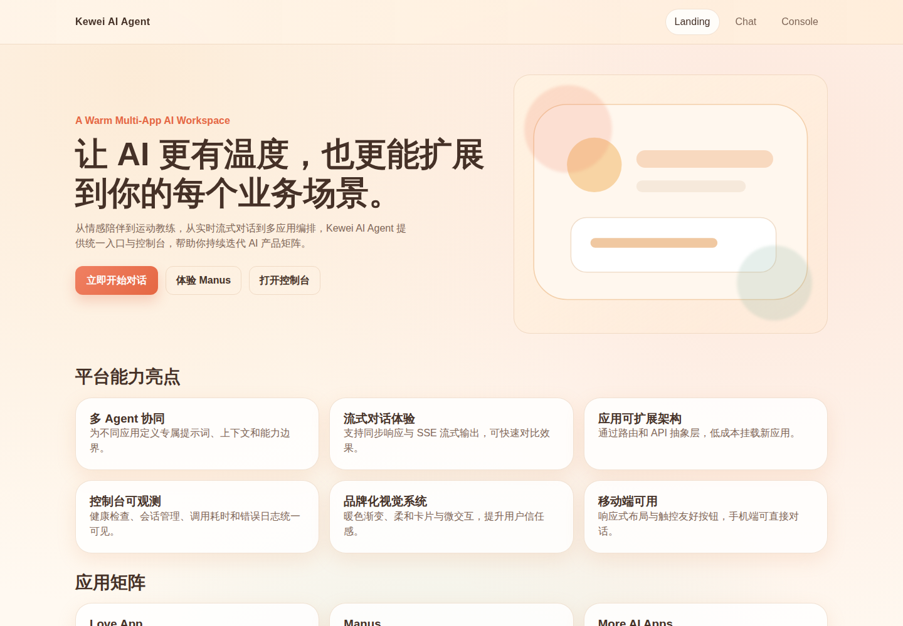
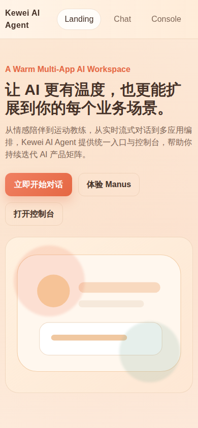
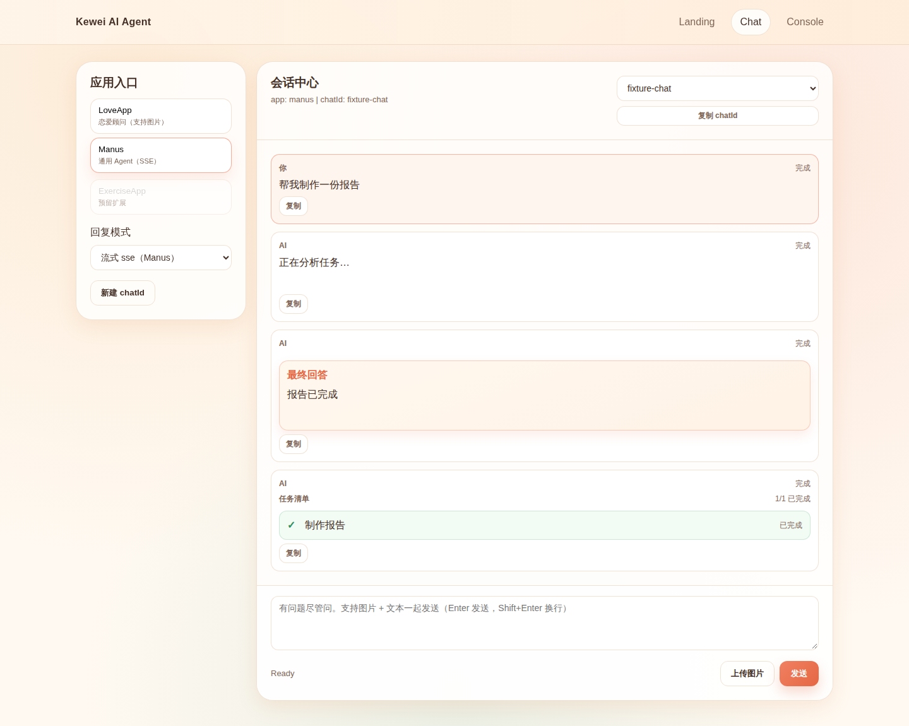
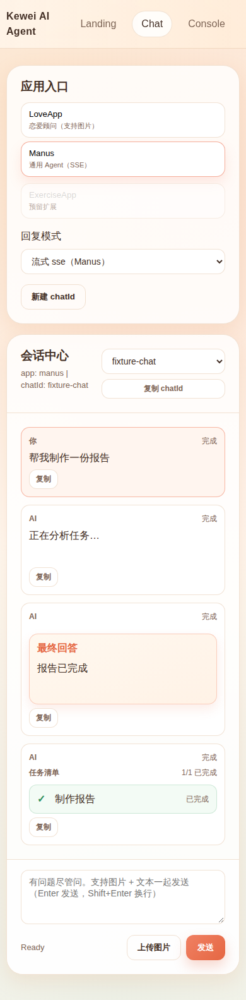
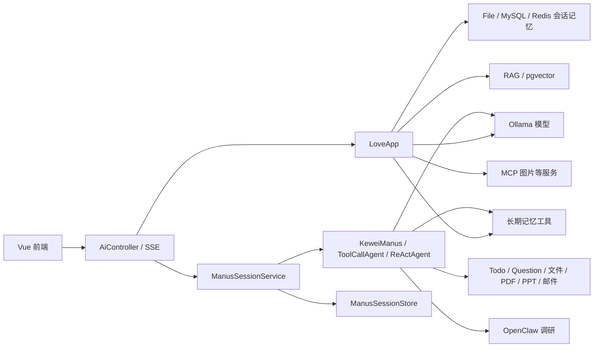

# Kewei AI Agent

[English](README.md) | **简体中文**

基于 **Spring Boot + Spring AI + Vue 3** 的 AI Agent 实践项目。你可以在浏览器中体验恋爱场景对话、流式回复和多步任务，也可以从代码了解 RAG、工具调用、MCP、会话状态和长期记忆的实现。

项目面向学习、二次开发和本地演示。当前默认模型为 Ollama，完整后端需要配置模型、数据库及启用的 MCP 服务；前端可以独立启动预览。项目尚未提供生产环境所需的完整鉴权、限流与审计能力，不建议直接暴露到公网。

[界面截图](#界面截图) · [快速开始](#快速开始) · [使用示例](#使用示例) · [ToolTape](#可选-tooltape-集成) · [部署与多平台使用](#部署与多平台使用) · [测试](#测试) · [架构与代码导航](#架构与代码导航) · [升级记录](#升级记录) · [下一步升级](#下一步升级)

## 界面截图

以下是[已通过的 CI 运行](https://github.com/keweizhuazuki/kewei-ai-agent/actions/runs/38033736809)对提交 `3027eeb` 构建后 Vue 前端首页的真实截图。截图仅展示 Chromium 中的前端视口预览，未连接真实后端或模型；移动视口截图不代表手机实机验证。

**桌面视口 · 1440 × 1000**



<details>
<summary>移动视口 · 390 × 844</summary>



</details>

### Manus 会话与已完成 Todo

以下是提交 `d23f0ab` 在[已验证的浏览器运行](https://github.com/keweizhuazuki/kewei-ai-agent/actions/runs/38035118112)中，完成提问续跑与失败重试后的真实 Chromium 整页截图。API/SSE 响应来自拦截后的合成测试数据，**不是真实模型输出**。浏览器视口为 1440 × 1000 和 390 × 844，不代表手机实机验证。

<details>
<summary>桌面会话 · 整页截图 1440 × 1150</summary>



</details>

<details>
<summary>移动会话 · 整页截图 390 × 1583</summary>



</details>

## 能做什么

| 能力 | 当前实现与边界 |
| --- | --- |
| LoveApp 对话 | 同步 / SSE 流式回复、会话记忆、图片问答；图片理解取决于所用模型 |
| Manus 多步任务 | 工具调用、TodoWrite 进度、AskUserQuestion 补充信息、回答后续跑 |
| RAG | Markdown 文档加载、本地向量库 / pgvector、查询预处理、关键词增强与检索过滤；主要在应用层提供 |
| 记忆 | file / MySQL / Redis 会话记忆；独立的 Markdown 长期记忆工具 |
| 工具 | 文件读写、资源下载、PDF 转图、PPT 生成、时间查询、邮件发送；外部服务须自行配置 |
| 扩展 | 图片搜索 / 图片生成 MCP 子项目；通过 OpenClaw CLI 委派网页调研 |
| 浏览器界面 | 首页 `/`、会话中心 `/chat`、健康检查与 API 调试 `/console`；ExerciseApp 为预留入口 |

技术栈：Java 21、Spring Boot 4、Spring AI 2.0.0-M2、Maven、Vue 3、Vite 7、Pinia、Ollama、PostgreSQL / pgvector。仓库也保留 DashScope 依赖与示例，但默认排除了其自动配置；切换 Provider 需要同步检查配置及模型 Bean，不能只修改 API Key。

## 快速开始

### 1. 先运行前端界面

只看界面不需要模型、数据库或 API Key。准备 Git、**Node.js 22.12+** 和 npm，在终端执行：

```bash
git clone https://github.com/keweizhuazuki/kewei-ai-agent.git
cd kewei-ai-agent/kewei-ai-agent-frontend
npm ci
npm run dev
```

以上命令同样适用于 Windows PowerShell。打开终端打印的地址，默认是 `http://localhost:5173`。没有后端时可以浏览页面，但聊天、图片上传和健康检查不会成功。

> 版本依据：锁定的 Vite 7 与 Vue 插件要求 Node `^20.19.0 || >=22.12.0`，Node 18 不满足要求。后端编译需要 **JDK 21**，仅安装 JRE 不够。仓库自带 Maven Wrapper，无需另装 Maven；首次使用会下载 Maven 和依赖。

### 2. 准备完整后端的依赖

| 依赖 | 何时需要 |
| --- | --- |
| Ollama | 默认聊天与 embedding；启动时就会加载文档并调用模型 |
| PostgreSQL + pgvector | 默认后端的数据源与向量存储；当前不是开箱即用的可选模块 |
| MCP 服务 | 默认配置已启用客户端，必须检查配置中的每个服务是否能启动 |
| MySQL / Redis | 选择对应会话记忆实现时；初次运行可使用 `file` |
| OpenClaw CLI | 网页调研及需要调研的 PPT 任务 |
| SMTP / 图片服务凭据 | 使用发邮件、图片搜索或生成等对应功能时 |

Ollama 默认地址为 `http://localhost:11434`，模型名见 [`application.yml`](src/main/resources/application.yml)：

```bash
ollama pull qwen3.5:35b
ollama pull mxbai-embed-large:latest
```

`qwen3.5:35b` 对本机资源要求较高，可在本地配置中改成适合设备的模型；工具调用、图片理解等能力需要模型支持。默认 pgvector 维度为 `1024`，更换 embedding 模型时应同时检查维度与已有向量数据。

创建 PostgreSQL 数据库，并由有权限的账号在该数据库启用扩展：

```sql
CREATE EXTENSION IF NOT EXISTS vector;
```

### 3. 添加本地配置

在 `src/main/resources/application-local.yml` 创建私有配置。默认启用 `local,ollama` profile；该本地文件被 Git 忽略，不要提交真实密钥或密码。

以下是数据库与文件记忆配置起点，需要先设置对应环境变量：

```yaml
spring:
  datasource:
    url: ${POSTGRES_URL}
    username: ${POSTGRES_USERNAME}
    password: ${POSTGRES_PASSWORD}
    driver-class-name: org.postgresql.Driver
  sql:
    init:
      mode: never

app:
  chat-memory:
    type: file
    file-dir: ${CHAT_MEMORY_DIR:${user.dir}/tmp/chat-memory}
  long-term-memory:
    dir: ${LONG_TERM_MEMORY_DIR:${user.dir}/tmp/agent-memory}
```

`POSTGRES_URL` 使用 JDBC 格式，例如 `jdbc:postgresql://localhost:5432/kewei_ai_agent`。macOS / Linux 用 `export NAME='value'` 设置当前终端环境变量，PowerShell 用 `$env:NAME='value'`；启动后端的终端必须能读取这些变量。敏感值请在自己的环境中填写。

按需在同一文件中补充：

- MySQL 会话记忆：`app.chat-memory.type=mysql`，并设置 `app.datasource.mysql.url / username / password / driver-class-name`，驱动为 `com.mysql.cj.jdbc.Driver`。
- Redis 会话记忆：`app.chat-memory.type=redis`，配置 `spring.data.redis.host / port` 及所需认证。
- 邮件：`mail.smtp.host / port / username / password / from / ssl`。配置后邮件工具会实际发信，请使用专用测试账号和收件人。
- OpenClaw：`openclaw.agent.command / id / timeout-seconds / session-prefix`。默认命令为 `openclaw`，需在后端进程的 PATH 中可用，并完成其自身配置。
- 独立网页搜索工具：`search-api.api-key`；当前 Manus 调研路由使用 OpenClaw，并非自动调用该搜索工具。

**MCP 需要单独检查。** [`mcp-servers.json`](src/main/resources/mcp-servers.json) 包含高德服务的占位 Key 和两个本地 JAR 的相对路径，不能原样当作可运行配置。先配置需要的服务及其凭据，再构建对应子项目；命令从仓库根目录执行：

```bash
./mvnw -f kewei-image-search-mcp-server/pom.xml package -DskipTests
./mvnw -f kewei-image-generation-mcp-server/pom.xml package -DskipTests
```

PowerShell 将 `./mvnw` 换成 `.\mvnw.cmd`。上面跳过了测试，只用于构建。可将私有 MCP 配置放在已忽略的 `tmp/mcp-servers.json`，并在本地配置里设置 `spring.ai.mcp.client.stdio.servers-configuration: file:./tmp/mcp-servers.json`。保留的每个服务都应可启动；目前 `LoveApp` 还注入 MCP 的 `ToolCallbackProvider`，关闭整个 MCP 客户端前需同步检查 Bean 装配。

### 4. 启动后端

回到仓库根目录，保留前端终端，在另一个终端启动：

macOS / Linux：

```bash
./mvnw spring-boot:run
```

Windows PowerShell：

```powershell
.\mvnw.cmd spring-boot:run
```

- 后端 API：`http://localhost:8123/api`
- 健康检查：`http://localhost:8123/api/health`
- Swagger：`http://localhost:8123/api/swagger-ui.html`

先打开 `/health` 确认后端可达，再回到前端 `/console` 点击“立即检查”。健康检查成功只说明 HTTP 服务可用，不代表所有模型与工具均已验证。首次文档向量化或关键词增强可能较慢，请查看启动日志。

## 使用示例

以下是可以复制尝试的输入与操作步骤，不是预录的模型输出；实际结果取决于模型、工具配置与服务状态。

### LoveApp：带上下文的对话

1. 进入 `/chat`，选择 **LoveApp**，回复模式选择“事件流 sse_emitter”。
2. 输入：`我和伴侣最近常因家务分工争执，想先梳理一次平和沟通的提纲。`
3. 保持相同 `chatId`，继续问：`把刚才的提纲压缩成三句开场白。`
4. 点击“新建 chatId”开始另一段会话。图片问答可先“上传图片”再发送问题，需要支持图片的模型。

前端会记住最近使用的 `chatId`，但页面消息列表不等于服务端历史记录。会话记忆由后端所选实现保存；不要把切换或刷新页面当成完整历史恢复功能。

### Manus：计划 → 补充信息 → 继续执行

在 `/chat` 选择 **Manus**，尝试输入：

```text
帮我制定一个三天的 Spring AI 学习计划。请先用 AskUserQuestion 确认我每天可用的时间，再用 TodoWrite 列出任务，最后逐项给出练习建议。不需要联网调研或发送邮件。
```

当模型调用相关工具时：

1. `question` 事件触发“需要补充信息”面板。
2. 回答问题并点击“继续执行”，前端将答案提交到续跑接口。
3. `todo` 事件更新“当前任务”进度，完成的任务快照会归档到聊天历史。
4. `message` 事件追加输出，`done` 结束当前流；流失败时应检查报错后再重试。

工具是否被调用由模型决定。Manus 的待回答状态和 Todo 快照保存在进程内存中，重启后端不能恢复未完成的任务；它们与文件 / MySQL / Redis 聊天记忆是两套机制。

回复进行中会禁用新建、切换会话与切换应用。暂停等待补充信息后，切换会话或应用会清除界面中旧的问题、答案与置顶 Todo；Manus 会初始化为 SSE 模式。续跑失败会保留答案，便于在同一会话重试；成功续跑会更新并归档最新 Todo 状态。

### API 示例

接口均以 `http://localhost:8123/api` 为前缀：

| 方法 | 路径 | 用途 |
| --- | --- | --- |
| GET | `/health` | HTTP 健康检查 |
| GET | `/ai/love_app/chat/sync` | 同步聊天 |
| GET | `/ai/love_app/chat/sse` | 普通流式聊天 |
| GET | `/ai/love_app/chat/sse_emitter` | 带 `message` / `done` 命名事件的聊天 |
| POST | `/ai/love_app/image/upload` | multipart 图片上传：`chatId`、`file` |
| GET | `/ai/manus/chat` | 启动 Manus：`chatId`、`message` |
| POST | `/ai/manus/chat/continue` | 提交答案并流式续跑 |

macOS / Linux 流式调用示例：

```bash
curl -N -G 'http://localhost:8123/api/ai/love_app/chat/sse_emitter' \
  --data-urlencode 'chatId=readme-demo' \
  --data-urlencode 'message=请帮我梳理一次平和沟通的提纲'
```

PowerShell 使用 `curl.exe`，避免与别名混淆：

```powershell
curl.exe -N -G "http://localhost:8123/api/ai/love_app/chat/sse_emitter" --data-urlencode "chatId=readme-demo" --data-urlencode "message=请帮我梳理一次平和沟通的提纲"
```

续跑接口的 JSON 形状如下，`answers` 的键必须替换为实际 `question` 事件返回的 ID：

```json
{
  "chatId": "readme-demo",
  "answers": {
    "实际问题ID": "每天一小时"
  }
}
```

Todo 最小演示可调用 `/ai/love_app/chat/sse_emitter` 并传入 `option=todo-demo`；完整问题补充与 Todo 进度交互使用 Manus 链路。

## 可选 ToolTape 集成

[ToolTape](https://github.com/keweizhuazuki/tooltape)录制与回放的是**工具回调**，不是模型回答或整个 Agent 运行。此可选适配器包装 `allTools` 与 `memoryTools` Bean；MCP Provider 和数组之外的操作不在拦截范围内。完整应用仍需要原有模型与依赖服务。

### 构建并测试固定版本

从仓库根目录初始化仓库锁定版本的子模块，再启用 Maven profile：

```bash
git submodule update --init --recursive
./mvnw -Ptooltape clean "-Dtest=ToolTape*,ToolCallAgentTest,ToolRegistrationTest" test
./mvnw -Ptooltape package -DskipTests
```

PowerShell 使用 `.\mvnw.cmd`。可复现构建不要使用 `git submodule update --remote`。不带 `-Ptooltape` 的干净默认构建不包含 ToolTape 及适配器；即使启用该 profile，运行时默认仍为 `off`。切换构建 profile 时使用 `clean` 清除旧的编译产物。

### 运行时配置

| 属性 | 默认值 | 含义 |
| --- | --- | --- |
| `kewei.tooltape.mode` | `off` | 可选 `off`、`record`、`replay` |
| `kewei.tooltape.path` | 未设置 | 录制/回放时必填；录制拒绝覆盖已有文件 |
| `kewei.tooltape.input-fields` | 空 | 经审查的顶层标量输入字段白名单，以逗号分隔；未纳入的值不录制、不比较 |
| `kewei.tooltape.capture-output` | `false` | 显式允许保存完整工具返回字符串 |

**隐私优先：** 默认输入/输出白名单为空，只保留工具名称、顺序、耗时与异常类型，不保存参数值或返回值。未捕获返回值的记录无法精确回放：回放会明确报错，不返回占位结果，也不会回退调用真实工具。`ToolContext` 仅在内存中透传，不写入记录。这些默认策略仅适用于记录文件，不改变现有应用日志或模型请求。

**输出捕获仅用于已审查的合成测试数据。** `capture-output=true` 会原样保存整个返回字符串，可能包含凭据或隐私数据，并不提供内容清洗。请审查每个输入与输出，使用独立测试进程，不提交记录文件。录制会执行真实包装工具，并可能产生副作用。建议先运行不需要真实模型的[合成 Agent 调度回归测试](src/tooltape-test/java/com/kiwi/keweiaiagent/tooltape/ToolTapeAgentReplayTest.java)。

如需用已审查合成数据尝试运行时捕获，先创建 `tmp/tooltape` 目录（macOS/Linux：`mkdir -p tmp/tooltape`；PowerShell：`New-Item -ItemType Directory -Force tmp/tooltape`），再运行：

```bash
java -jar target/kewei-ai-agent-0.0.1-SNAPSHOT.jar --kewei.tooltape.mode=record --kewei.tooltape.path=tmp/tooltape/synthetic.tape --kewei.tooltape.capture-output=true
```

在**一个串行测试会话**中实际调用相关包装工具，结束后正常关闭应用，让 Spring 关闭录制器并写入完成标记。随后使用相同捕获策略重启，回放相同顺序的工具调用：

```bash
java -jar target/kewei-ai-agent-0.0.1-SNAPSHOT.jar --kewei.tooltape.mode=replay --kewei.tooltape.path=tmp/tooltape/synthetic.tape --kewei.tooltape.capture-output=true
```

示例保持输入白名单为空；如需比较特定参数，在两次运行中设置相同且已审查的 `kewei.tooltape.input-fields`。新 v2 记录必须已关闭且策略一致；缺失文件、记录不完整或策略不匹配均会失败。关闭回放器时还会检查所有记录调用是否消费完毕。

适配器使用进程级有序会话，拒绝并发或递归工具调用，暂不适合生产环境多用户捕获。回放仅替换被包装的工具，模型若未另行 stub 仍会真实运行，也可能生成不同的调用顺序。

## 部署与多平台使用

### 构建与 API 地址

前端默认连接 `http://localhost:8123/api`。这是**浏览器所在设备**的 localhost；部署到服务器或用手机访问时，必须改为该设备能访问的后端地址。

在 `kewei-ai-agent-frontend/.env.local` 配置，例如：

```dotenv
VITE_API_BASE_URL=https://your-api.example.com/api
```

这是示例地址，需要替换，保留 `/api` 前缀且不要在末尾加 `/`。若同源反向代理已把 `/api` 转发到后端，也可设置 `VITE_API_BASE_URL=/api`。当前 Vite 开发配置没有 API 代理，前后端分端口开发时仍使用完整后端 URL。

`VITE_` 变量会进入公开前端产物，不能存密钥；它们在构建时注入，修改后需要重新构建：

```bash
cd kewei-ai-agent-frontend
npm ci
npm run build
npm run preview
```

`npm run preview` 用于本地检查 `dist`，不是生产服务。部署静态产物时：

- 将 `dist` 交给静态服务器，给 `/chat`、`/console` 等 history 路由配置回退到 `index.html`。
- HTTPS 页面应连接 HTTPS API，避免浏览器混合内容拦截。
- 反向代理要支持 SSE，检查缓冲和读超时设置。
- 公网发布前补上鉴权、工具执行权限和限流，并收紧当前宽松的 CORS 配置。

后端从仓库根目录打包：

```bash
./mvnw package -DskipTests
java -jar target/kewei-ai-agent-0.0.1-SNAPSHOT.jar
```

PowerShell 的打包命令用 `.\mvnw.cmd package -DskipTests`，`java -jar` 相同。该命令跳过测试，不代表验证通过。模型、数据库、MCP 和私有配置仍须就绪；文件输出、记忆和 MCP 相对路径取决于进程工作目录，建议从仓库根目录运行。

### 平台说明

新增 Windows/macOS CI 使用原生 Maven Wrapper，检查隔离的后端测试、默认打包及前端测试/构建（依赖安装使用 `npm ci --ignore-scripts`），记录运行版本并保留含跳过项的测试报告。首次托管结果仍待确认，不代表完整服务启动或这些系统上的浏览器已验证。

| 平台 | 运行方式与验证情况 |
| --- | --- |
| Linux | 本次已在 Linux 云环境验证选定后端单测、前端测试与构建；未验证完整外部服务联调 |
| macOS | 使用 `./mvnw` 和 npm 命令；尚未进行 macOS 运行验证 |
| Windows | 使用 PowerShell、`.\mvnw.cmd` 和 `curl.exe`；尚未进行 Windows 运行验证 |
| 手机 / 平板 | 作为浏览器客户端访问已部署的前端；不在手机上运行 Java 后端或 Ollama |

局域网调试可用 `npm run dev -- --host 0.0.0.0` 暴露前端，并将 API 地址设置为后端机器的局域网地址。仅在可信网络下使用，检查设备互通和防火墙；不要将开发服务器直接开放到公网。

## 测试

从仓库根目录运行后端核心回归测试（不调用真实模型）：

```bash
./mvnw "-Dtest=BaseAgentTest,ManusSession*Test,Memory*Test,FileOperationToolTest,ResourceDownloadToolTest,PdfConvertToolTest,OpenClawResearchToolTest,ShellOpenClawCommandRunnerTest" test
./mvnw -DskipTests compile
```

Windows 用 `.\mvnw.cmd` 替换 `./mvnw`。前端使用 Node 内置测试运行器，覆盖 SSE 解析、URL、连接生命周期与会话状态回归：

```bash
cd kewei-ai-agent-frontend
npm ci
npm test
npm run build
```

仓库也包含 `./mvnw test` 全量测试，但部分 `@SpringBootTest` 会启动应用并依赖真实模型、数据库、MCP 或网络；不能把以上核心测试通过等同于全量测试通过。PDF 转图测试会临时生成样本，验证子目录保留与同名冲突处理，不需要私人 PDF；邮件手工测试默认禁用。浏览器交互、真实模型回答及外部服务应另做联调验证。

[回归检查工作流](.github/workflows/ci.yml)会在 PR 和 `main` 推送时运行：Java 21 执行 19 个无需外部服务的后端测试类，Node 24 运行前端测试与生产构建。官方 Actions 固定到提交 SHA，仅授予仓库只读权限，不使用应用密钥；真实模型、数据库、SMTP 和公网服务联调测试不在此范围内。

前端任务还会用 Playwright 截取实际桌面/移动视口，并上传 `ui-previews` 产物。预览只启动构建后的界面，不启动后端或模型。构建后可在本地执行相同截图：

```bash
npx playwright install chromium
npm run screenshots
```

在 `kewei-ai-agent-frontend` 内执行，并使用支持浏览器运行的环境。图片输出到 `docs/images/`，经实际查看确认后再放入文档。

完成 `npm run build` 并安装 Chromium 后，可运行新增的模拟数据浏览器交互检查：

```bash
npm run test:ui
npm run test:ui -- --screenshots
```

第二条命令同时请求生成聊天截图。[浏览器测试](kewei-ai-agent-frontend/scripts/ui-flows.mjs)使用真实 Chromium，但拦截 API/SSE 并返回合成数据：覆盖续跑失败重试与 Todo 完成、新建会话、切换会话、发送失败后重试、切换应用五类场景，各在桌面与移动尺寸视口执行，共 **10 个场景**。这些场景已在提交 `d23f0ab` 的[托管 CI](https://github.com/keweizhuazuki/kewei-ai-agent/actions/runs/38035118112)中全部通过，生成的聊天截图也已实际检查并收录在上方；不涉及真实后端或模型。


## 架构与代码导航



- [应用层 LoveApp](src/main/java/com/kiwi/keweiaiagent/app/LoveApp.java)：文本、结构化输出、图片、RAG、Tools、MCP 与 Skills 的调用入口；并非所有方法都有独立前端按钮。
- [ManusSessionService](src/main/java/com/kiwi/keweiaiagent/agent/ManusSessionService.java) / [ManusSessionStore](src/main/java/com/kiwi/keweiaiagent/agent/ManusSessionStore.java)：任务路由、工具子集、补充问题、Todo 快照与续跑。
- [ChatMemoryConfig](src/main/java/com/kiwi/keweiaiagent/config/ChatMemoryConfig.java)：会话记忆切换；[RAG 配置](src/main/java/com/kiwi/keweiaiagent/rag)：文档加载、向量化与检索。
- [ToolRegistration](src/main/java/com/kiwi/keweiaiagent/tools/ToolRegistration.java)：注册工具；[OpenClawResearchTool](src/main/java/com/kiwi/keweiaiagent/tools/OpenClawResearchTool.java)：调用 `openclaw agent --json` 并整理调研结果。
- [MemoryToolSupport](src/main/java/com/kiwi/keweiaiagent/tools/MemoryToolSupport.java)：六个长期记忆工具的文件操作边界。默认 `tmp/agent-memory`，以 `MEMORY.md` 索引分类 Markdown 文件，拒绝越界和符号链接操作。
- [前端 SSE 客户端](kewei-ai-agent-frontend/src/api/sse.js)：GET EventSource 与 POST fetch 流处理；[前端会话页面](kewei-ai-agent-frontend/src/views/ChatView.vue)：消息、补充问题与 Todo 展示。

```text
kewei-ai-agent/
├── src/main/java/com/kiwi/keweiaiagent/   # API、应用、Agent、配置、工具
├── src/main/resources/                  # 配置、提示词、RAG 文档、Skills
├── src/test/                            # 单测、集成与手工测试
├── kewei-ai-agent-frontend/              # Vue 3 前端
├── kewei-image-search-mcp-server/        # 图片搜索 MCP
├── kewei-image-generation-mcp-server/    # 图片生成 MCP
├── CONTRIBUTING.md                      # 协作规范
└── PROCEDURES.md                        # 开发过程记录
```

## 常见问题

- **`npm ci` 提示 engine 不匹配**：先检查 `node -v`，使用满足上述 Vite 版本要求的 Node。
- **后端启动失败**：优先查看第一条异常，核对 JDK、PostgreSQL 连接、`vector` 扩展、Ollama 模型和 MCP 子进程；不要只看前端“网络异常”。
- **页面打开但无法聊天**：确认 `/api/health` 可达、API 地址正确，再检查模型服务；手机上的 localhost 不会指向电脑。
- **一直没有流式输出**：检查后端日志、模型加载情况、反向代理的 SSE 缓冲与超时；`/console` 可用于定位具体接口。
- **续跑提示找不到会话**：检查 `chatId` 是否一致，以及后端是否重启；Manus 待执行状态不持久化。
- **文件 / 记忆工具拒绝路径**：使用各工具输出目录内的相对路径，不使用绝对路径、`..` 越界路径或符号链接。

## 升级记录

### 2026-10-10

以下已实现升级关联对应 PR 与真实提交，尚未完成的托管验证会明确标注；属于维护记录，不代表新发布版本。

| 已完成升级 | 依据 |
| --- | --- |
| 拒绝空的记忆替换目标 | [#1](https://github.com/keweizhuazuki/kewei-ai-agent/pull/1) · `2c6da53` |
| 拒绝记忆路径中的符号链接 | [#2](https://github.com/keweizhuazuki/kewei-ai-agent/pull/2) · `c50cebb` |
| 阻止破坏记忆根目录及意外覆盖 | [#3](https://github.com/keweizhuazuki/kewei-ai-agent/pull/3) · `fbdca5a` |
| 清理中断后的调研子进程 | [#4](https://github.com/keweizhuazuki/kewei-ai-agent/pull/4) · `69dd7af` |
| 保留 SSE 错误与跨数据块事件边界 | [#5](https://github.com/keweizhuazuki/kewei-ai-agent/pull/5) · `e009b9a` |
| 将文件与下载操作限制在工具目录内 | [#6](https://github.com/keweizhuazuki/kewei-ai-agent/pull/6) · `7e6025a` |
| 修正同步 Agent 的终止状态 | [#7](https://github.com/keweizhuazuki/kewei-ai-agent/pull/7) · `87ec5d7` |
| 原子消费答案，隔离会话快照 | [#8](https://github.com/keweizhuazuki/kewei-ai-agent/pull/8) · `ad677a4` |
| 保留 PDF 子目录，检测同次转换的图片名称冲突 | [#9](https://github.com/keweizhuazuki/kewei-ai-agent/pull/9) · `d78ed7a` |
| 支持同源反向代理下的相对 SSE API 地址 | [#10](https://github.com/keweizhuazuki/kewei-ai-agent/pull/10) · `6006c36` |
| 补充实用启动、使用、部署与多平台说明 | [#11](https://github.com/keweizhuazuki/kewei-ai-agent/pull/11) · `8d1b783` |
| 拆分英文默认页与中文入口，同步升级计划 | [#12](https://github.com/keweizhuazuki/kewei-ai-agent/pull/12) · `8e34155` |
| 增加隔离的 CI 回归检查与自动界面截图 | [#13](https://github.com/keweizhuazuki/kewei-ai-agent/pull/13) · `3027eeb` |
| 完成并展示首批桌面与移动视口前端真实截图 | [#14](https://github.com/keweizhuazuki/kewei-ai-agent/pull/14) · `670ec50` |
| 增加可选 ToolTape 录制/回放，修正 Agent 回调调度 | [#15](https://github.com/keweizhuazuki/kewei-ai-agent/pull/15) · `74a73ad` |
| 修复 Manus 续跑状态、SSE 模式初始化与会话/应用切换，补充已验证的模拟浏览器流程 | [#16](https://github.com/keweizhuazuki/kewei-ai-agent/pull/16) · `4542019`, `d23f0ab` |

**ToolTape 验证：** 新增可选 ToolTape 适配器，并修正 `ToolCallAgent` 调度，将可用回调传给 Spring AI。基于固定 ToolTape 提交 `7d08b44`，Linux 本地已通过 **90 项默认构建回归测试**、**22 项启用 profile 的测试及打包**；干净默认构建不含 ToolTape 核心或适配器类。[合成 Agent 回归](src/tooltape-test/java/com/kiwi/keweiaiagent/tooltape/ToolTapeAgentReplayTest.java)使用确定性本地模型 stub 验证 `think → act`，确认回放不会再次触发工具副作用。相同后端/profile 范围也已通过[托管 CI](https://github.com/keweizhuazuki/kewei-ai-agent/actions/runs/38034533505)。

**前端验证：** 修复续跑 Todo 解码、会话/应用切换后残留问题、Manus 回复模式初始化与回复期间切换问题。提交 `d23f0ab` 的[运行 38035118112](https://github.com/keweizhuazuki/kewei-ai-agent/actions/runs/38035118112)已通过 **90 项后端测试、22 项 ToolTape profile 测试及打包、43 项 Node 测试、前端构建和全部 10 个 Chromium 场景**。桌面与移动会话截图已实际检查；浏览器响应使用合成 API/SSE 数据，不是真实模型输出。

**已验证的 CI 运行：** [运行 38033736809](https://github.com/keweizhuazuki/kewei-ai-agent/actions/runs/38033736809)已通过 89 项核心后端测试、33 项前端测试、前端生产构建与桌面/移动视口截图。[工作流](.github/workflows/ci.yml)无需真实服务凭据，已检查的截图现已收录在上方。

**本次跨平台修订：** [工作流](.github/workflows/ci.yml)新增只读的 Windows/PowerShell 与 macOS/Bash 兼容性检查。原生 Wrapper 执行和报告仍待首次托管运行确认；不区分大小写的文件系统可能跳过 PDF 大小写冲突测试。

**验证边界：** 托管 Linux 环境已验证核心测试、前端构建、真实 Chromium 截图及 10 个模拟浏览器场景；真实模型会话、实际外部服务联调、更广泛的中断恢复、Windows/macOS 运行和手机实机验证仍未完成。

## 下一步升级

以下保留原有路线图，并补充当前待办。前面的缺陷修复不代表这些更完整的目标已经完成。

- [ ] **任务观测面板：** 展示每一步的执行摘要、工具调用与状态变化，提供有用的执行信息，不展示模型私密推理过程。
- [ ] **长期记忆控制：** 增加更细粒度的权限、审计与同步策略。
- [ ] **生产环境防护：** 补充鉴权、工具授权、输入校验、限流、审计日志与 CORS 限制。
- [ ] **领域独立 Agent 与 MCP：** 按适合的任务域继续拆分独立 Agent 或 MCP 服务。
- [ ] **部署与在线演示：** 在已有部署说明上补充安全配置模板、最小后端启动路径与可选服务隔离；实际托管的在线演示仍待完成。
- [ ] **CI 覆盖：** 随功能增长维护无需外部服务的测试清单；服务环境就绪后，再增加安全隔离的联调任务。
- [ ] **真实会话截图：** 验证并截取模型对话、Manus 提问与 Todo 流程，与已完成的首页及合成响应聊天预览明确区分。
- [ ] **跨平台验证：** 验证新增的 Windows/macOS 原生检查，再单独测试完整服务启动。
- [ ] **浏览器与服务覆盖：** 在已验证的模拟 Chromium 流程上扩展真实模型/服务联调，以及更广泛的导航、中断与恢复场景。
- [ ] **ToolTape 隔离：** 在当前单一串行会话之外扩展前，增加会话级隔离与经过审查的逐工具捕获策略。
- [ ] **会话持久化：** 明确待执行 Manus 任务的过期与持久化方案，支持安全重启恢复。

## 参与开发

请遵循 `issue → branch → commit → test → PR → review → merge`，正常开发不直接推送 `main`。提交前检查测试结果、文档、密钥与机器专属路径，详见 [CONTRIBUTING.md](CONTRIBUTING.md)。完整开发记录见 [PROCEDURES.md](PROCEDURES.md)。

每次后续变更都应按日期补充已完成升级、依据与验证边界，更新下一步清单，并同步维护[英文](README.md)与[简体中文](README.zh-CN.md)版本。
